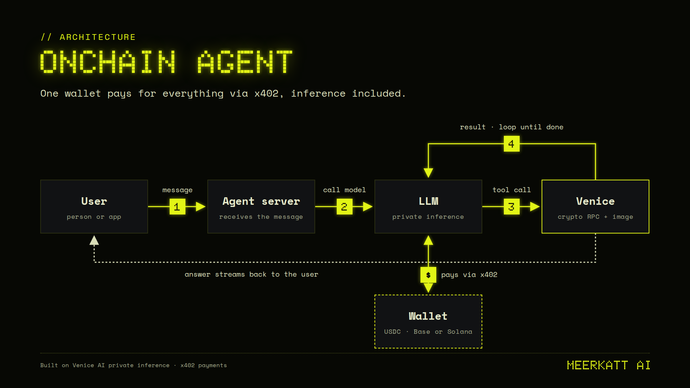

# Privacy first voice agent 

## Features

- **Powered by x402.** The agent signs a Sign-In-With-X message with its own wallet  and pays in USDC (Base or Solana) for *all* Venice routes. No account, no API key.

